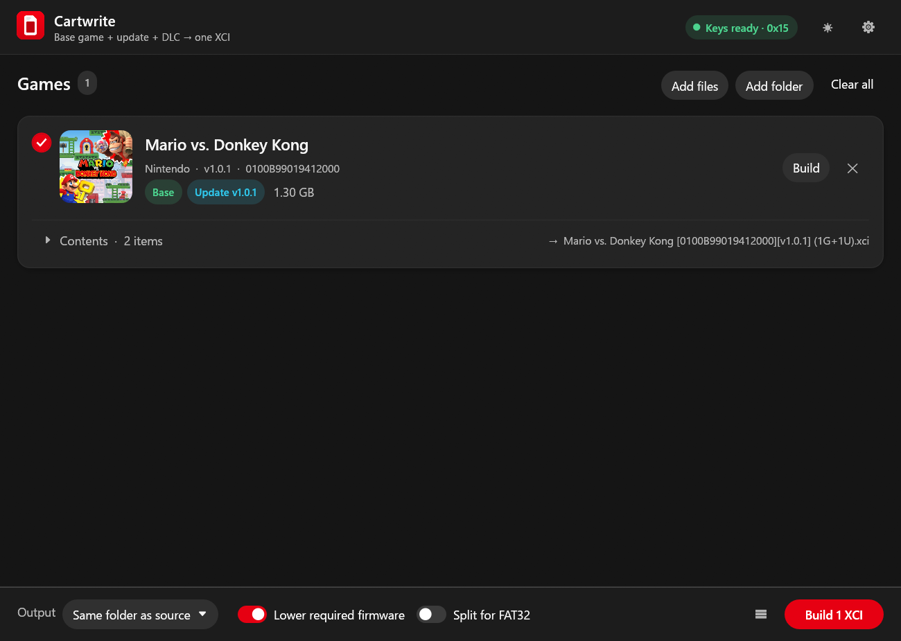
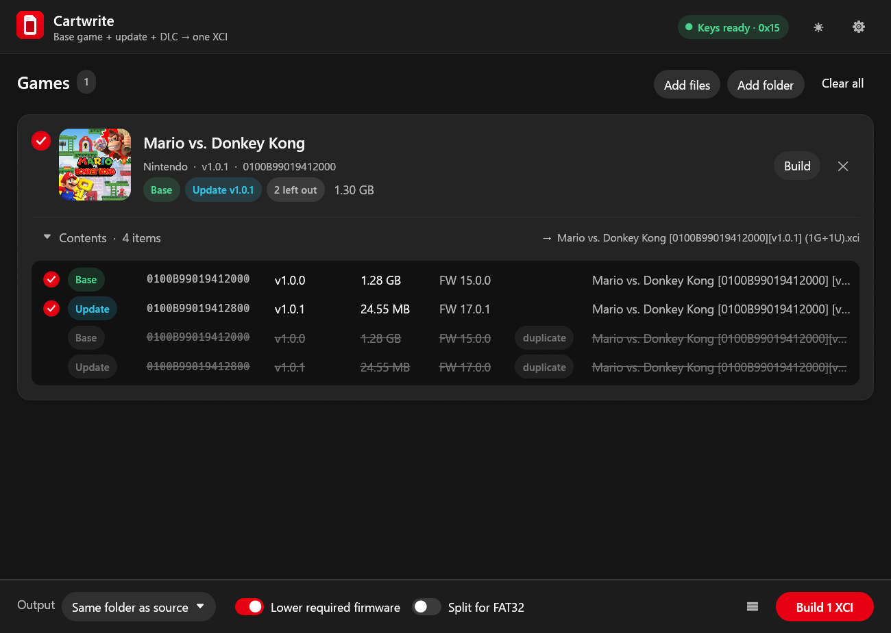

# Cartwrite

Cartwrite packs a Nintendo Switch game, its update and its DLC into a single XCI file. It is a
desktop app for Windows, Linux and macOS, written in Rust.

The usual use is keeping a library of XCIs up to date. When a new update or DLC comes out, drop
it into Cartwrite along with the XCI you already have, and it builds a new XCI with everything in
it.



## Features

- Reads NSP, NSZ, XCI and XCZ files, including XCIs that Cartwrite or NSC_Builder made earlier.
- Groups everything by game automatically and keeps only the newest update and the newest
  version of each DLC. Older and duplicate copies are listed but left out.
- Shows each game's name, icon, publisher and version before you build, so you can check what
  will go into the XCI and untick anything you don't want.
- Converts eShop content to standard crypto (moves the title key out of the ticket), so the
  XCI installs and runs without tickets.
- Can lower the required system version so the game doesn't ask for a system update it doesn't
  need (see [Options](#options)).
- Can split output into 4 GB parts for FAT32 SD cards.
- Dark and light themes.

## Getting started

### 1. Get the app

Download the latest zip from the [Releases](../../releases) page, extract it anywhere and run
`cartwrite.exe`. Windows builds are provided; on Linux and macOS, build it from source (see
[Building from source](#building-from-source)).

### 2. Add your keys

Cartwrite needs a `prod.keys` file dumped from your own console (for example with Lockpick_RCM).
No keys are included with the app.

Put `prod.keys` in any of these places and Cartwrite will find it:

- `%USERPROFILE%\.switch\prod.keys` (Windows) or `~/.switch/prod.keys` (Linux, macOS)
- next to the Cartwrite executable
- a `Keys` folder next to the executable

You can also pick the file in Settings. The badge in the top right turns green once the keys
are loaded and shows the newest master key they contain.


## Using Cartwrite

### Build an XCI from a game and its update

1. Drag the base game and its update (and any DLC) onto the window, or use **Add files** or
   **Add folder**.
2. Check the game card. It shows which parts were found: Base, Update and the number of DLC.
3. Click **Build** on the card, or the red button at the bottom (for example **Build 2 XCIs**)
   to build every selected game. Use the round check on each card to choose which games that
   button builds.

The XCI is written next to the source files unless you choose an output folder at the bottom
of the window.

### Update an XCI you already have

Drop the existing XCI together with the new update or DLC. Cartwrite takes the content from the
old XCI, replaces the old update with the new one and adds any new DLC. The old copies show up
as "left out" in the card's contents list.

If you turn on **Delete the old XCI after rebuilding it** in Settings, the old file is removed
once the new one has been written. Cartwrite only does this when everything in the old XCI
made it into the new one. If you untick a DLC that only exists in the old XCI, the old file is
kept.

### Check what will be included

Open **Contents** on a game card to see every title that was found, with its version, size,
required firmware and source file. Untick a row to leave it out of the build.



### Output file names

Files are named like this:

```
Super Mario Bros. Wonder [010015100B514000][v1.2.1] (1G+1U+3D).xci
```

- the game's name
- the base title ID
- the version players see in the game's menus (the internal patch number is used only if a
  title has none)
- what's inside: G for the base game, U for updates, D for DLC

## Options

Settings are in the gear menu. The most used ones are also at the bottom of the main window.


| Option | Default | What it does |
| --- | --- | --- |
| Lower required firmware | On | Each game records a minimum system version. Cartwrite lowers it to the first firmware that has the game's encryption key, so consoles on slightly older firmware aren't asked to update. It never lowers it below what the game can actually run on. |
| Split for FAT32 | Off | FAT32 SD cards can't hold files over 4 GB. With this on, large XCIs are written as `.xc0`, `.xc1` and so on. |
| Keep update delta fragments | Off | Delta fragments are only used by the eShop to patch an installed game. They are useless in an XCI, so they're left out by default. |
| Delete the old XCI after rebuilding it | Off | See [Update an XCI you already have](#update-an-xci-you-already-have). |
| Theme | Dark, NX style | Dark, light or follow the system. There is also a violet colour style. |

## Command line

`cartwrite-cli` does the same job from a terminal, which is handy for scripts.

```
cartwrite-cli info  <files or folders...>
cartwrite-cli build [-o DIR] [--no-rsv] [--fat32] [--deltas] [--keys FILE] <files or folders...>
```

- `info` lists every game found, with each title's version, size, required firmware and source.
- `build` writes one XCI per game into `DIR` (default `output`).
- `--no-rsv` turns off lowering the required firmware.
- `--fat32` splits large files into 4 GB parts.
- `--deltas` keeps update delta fragments.
- `--keys` points at a specific `prod.keys`.

The exit code is non-zero if any game failed to build.

## Building from source

You need a recent stable Rust toolchain (https://rustup.rs).

```
cargo build --release
```

This produces two programs in `target/release`:

- `cartwrite` (`cartwrite.exe` on Windows): the desktop app
- `cartwrite-cli`: the command-line version

On Windows the app icon is embedded in the executable. That step uses the Windows SDK's
resource compiler, which comes with the Visual Studio C++ build tools. Without it the build
still works but the `.exe` has no icon.

Run the tests with:

```
cargo test --workspace
```

### Project layout

| Path | Contents |
| --- | --- |
| `crates/cartwrite-core` | Keys, crypto, the NSP/XCI/NCA/NCZ formats, scanning and the XCI writer |
| `crates/cartwrite` | The desktop app (egui) |
| `crates/cartwrite-cli` | The command-line version |

## Limitations

- NCA2 and older content from the Switch's earliest firmware isn't supported.
- Content with a personalized (console-bound) ticket can't be converted.
- Output is XCI only. NSP output, NSZ compression, trimming and verification from NSC_Builder
  aren't ported yet.

## Credits

Cartwrite is a rewrite inspired by [NSC_Builder](https://github.com/julesontheroad/NSC_BUILDER)
by julesontheroad. The XCI layout, title rights conversion, required system version patching
and file naming follow NSC_Builder, which itself builds on blawar's nut and LucaFraga's
hacbuild. Format details were checked against [LibHac](https://github.com/thealexbarney/libhac).

Cartwrite is not affiliated with or endorsed by NSC_Builder's author or by Nintendo. It contains
no keys or copyrighted game content. You need to supply your own `prod.keys` from your own
console.

## License

GPL-3.0, the same license as NSC_Builder.
