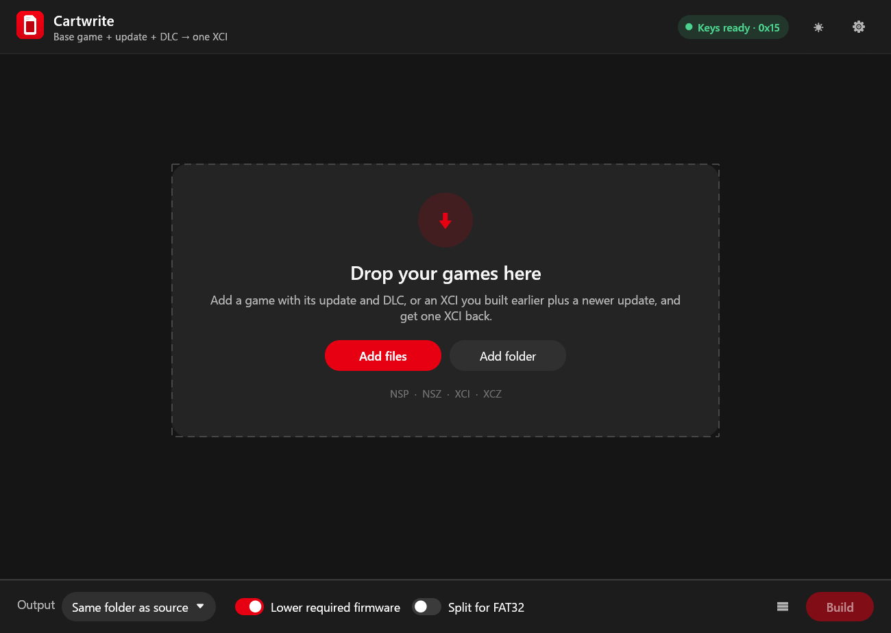
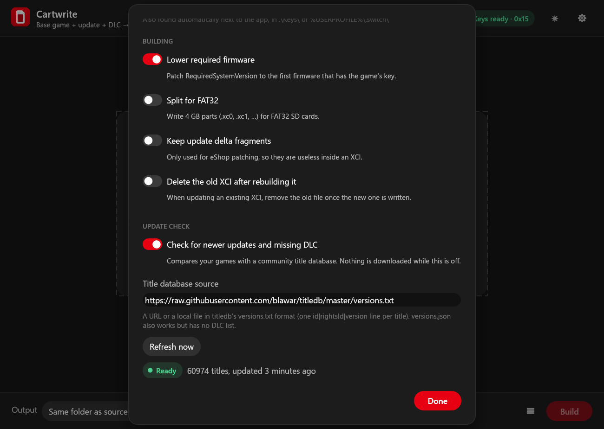
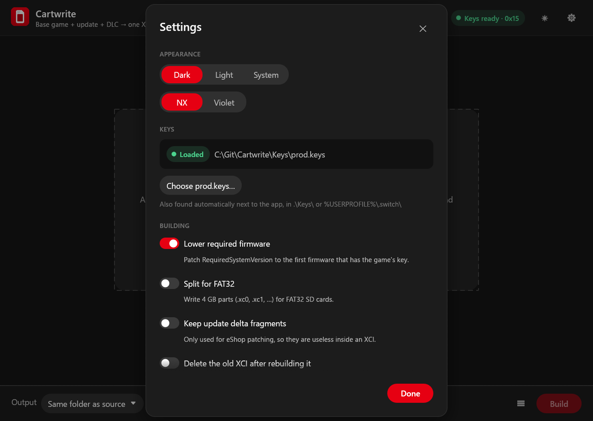

# Cartwrite

Cartwrite packs a Nintendo Switch game, its update and its DLC into a single XCI file. It is a
desktop app for Windows, Linux and macOS, written in Rust.

The usual use is keeping a library of XCIs up to date. When a new update or DLC comes out, drop
it into Cartwrite along with the XCI you already have, and it builds a new XCI with everything in
it.



## Features

- Reads NSP, NSZ, XCI and XCZ files, including XCIs that Cartwrite or NSC_Builder made earlier.
- Groups everything by game automatically and keeps only the newest update and the newest
  version of each DLC. Older and duplicate copies are listed but left out.
- Shows each game's name, icon, publisher and version before you build, so you can check what
  will go into the XCI and untick anything you don't want.
- Converts content that relies on a ticket to the standard encryption that game cards use,
  since an XCI has no place for tickets.
- Can lower the required system version so the game doesn't ask for a system update it doesn't
  need (see [Options](#options)).
- Can split output into 4 GB parts for FAT32 SD cards.
- Can also extract a game to a folder with its update applied (exefs, romfs and control), and
  optionally each DLC's data to a folder next to it, for example to look inside a game you own
  or to mod it.
- Optional check for newer updates and missing DLC against a title database you choose. Off by
  default.
- Optional region badges (US, EU, JP, Asia, KR) showing which eShop each release comes from.
  Off by default.
- Spots DLC that belong to a different release than the game they're packed with, which a
  game won't load.
- Dark and light themes.

## Getting started

### 1. Get the app

Download the package for your system from the [Releases](../../releases) page:

- **Windows:** `Cartwrite-<version>-windows-x64.zip`. Extract it anywhere and run `cartwrite.exe`.
- **Linux:** `Cartwrite-<version>-linux-x64.tar.gz`. Extract it and run `./cartwrite`. It needs an
  X11 or Wayland desktop, and its file dialogs use the XDG desktop portal.
- **macOS:** `Cartwrite-<version>-macos-universal.tar.gz`, for Apple silicon and Intel Macs.
  Extract it and open `Cartwrite.app`. The app isn't signed by Apple, so the first time,
  right-click it and choose **Open**.

You can also build it yourself (see [Building from source](#building-from-source)).

### 2. Add your keys

Cartwrite needs a `prod.keys` file dumped from your own console. No keys are included with the
app.

Put `prod.keys` in any of these places and Cartwrite will find it:

- `%USERPROFILE%\.switch\prod.keys` (Windows) or `~/.switch/prod.keys` (Linux, macOS)
- next to the Cartwrite executable
- a `Keys` folder next to the executable

You can also pick the file in Settings. The badge in the top right turns green once the keys
are loaded and shows the newest master key they contain.

## Using Cartwrite

### Build an XCI from a game and its update

1. Drag the base game and its update (and any DLC) onto the window, or use **Add files** or
   **Add folder**.
2. Check the game card. It shows which parts were found: Base, Update and the number of DLC.
3. Click **Build** on the card, or the red button at the bottom (for example **Build 2 XCIs**)
   to build every selected game. Use the round check on each card to choose which games that
   button builds.

The XCI is written next to the source files unless you choose an output folder at the bottom
of the window.

### Update an XCI you already have

Drop the existing XCI together with the new update or DLC. Cartwrite takes the content from the
old XCI, replaces the old update with the new one and adds any new DLC. The old copies show up
as "left out" in the card's contents list.

If you turn on **Delete the old XCI after rebuilding it** in Settings, the old file is removed
once the new one has been written. Cartwrite only does this when everything in the old XCI
made it into the new one. If you untick a DLC that only exists in the old XCI, the old file is
kept.

### Check what will be included

Open **Contents** on a game card to see every title that was found, with its version, size,
required firmware and source file. Untick a row to leave it out of the build.

### Extract a game to a folder

1. Click **Extract…** on the game card.
2. Choose **Game only** or **Game + DLC**. The choice is only offered when the game has DLC.
3. Pick the destination and click **Extract**.

The game is written to its own folder inside the destination, named like the XCI would be. DLC
goes to a second folder next to it, so the game folder only ever holds the game itself:

```
<name>/exefs/              main, main.npdm, rtld, sdk, subsdk*
<name>/romfs/              game data
<name>/logo/               boot logo (when present)
<name>/control/            control.nacp and icons
<name>/program<N>/...      the same for each further program of a multi-program title
<name> DLC/<id>/romfs/     each DLC's data, with its DLC update applied (Game + DLC only)
```

Tools that read an extracted game usually want `<name>`, the folder that holds `exefs` and
`romfs`.

- The update's RomFS patch is applied to the base game, so `romfs/` is the game as the console
  sees it.
- A base game is required. Without one, the **Extract…** button is greyed out.
- NSZ and XCZ input is decompressed to a temporary folder first, so you need some extra disk
  space while it runs. The temporary folder is removed afterwards.
- A cancelled or failed extraction leaves nothing behind. Files go into `<name>.partial` until
  everything is written.
- If the folders already exist, the button reads **Replace**. Cartwrite only replaces folders
  that are an earlier extraction.

### Check for newer updates and missing DLC

This is off by default. Turn on **Check for newer updates and missing DLC** in Settings and
each game card shows how your files compare with a community title database:

- **Up to date**: you have the newest update and every DLC the database lists.
- **Newer update available**: the database lists a later update than the one you have.
- **N DLC missing**: DLC the database lists that none of your files contain. Hover to see
  their title IDs.
- **N DLC outdated**: you have the DLC, but an older version of it.
- **Not in title database**: the database doesn't list this game.

How it works:

- The database is a single text file listing the newest version of every title. By default it
  comes from [blawar/titledb](https://github.com/blawar/titledb) (`versions.txt`, about 3 MB).
- It's downloaded in the background and cached, so it never holds up the app. The cached copy
  is used straight away and refreshed once it is more than a day old, or when you click
  **Refresh now**.
- If a download fails, Cartwrite says why (for example, that you're offline) and keeps using
  the last copy it had.
- You can change the source to any URL or to a local file, for example a copy you keep
  yourself or a different mirror. The file needs to be in titledb's `versions.txt` format: one
  `id|rightsId|version` line per title. titledb's `versions.json` also works, but it only
  covers updates, not DLC.
- Nothing about your games is sent anywhere. The database is downloaded and compared on your
  computer.



The check only tells you something newer exists. Cartwrite doesn't download game content.

### See which region each release is from

Switch title IDs don't say which region a release is from, and some games have separate
releases per region, each with its own title ID, update and DLC. Turn on **Show which region
each release is from** in Settings and each game card shows a small flag for every eShop
that lists it: US, EU, JP, Asia (Hong Kong eShop) and KR. Most games are sold worldwide under
one title ID and show several flags.

- The data comes from titledb's per-country eShop lists (`US.en.json`, `GB.en.json`,
  `JP.ja.json`, `HK.zh.json` and `KR.ko.json`). Together they're about 100 MB to download,
  so this is off by default.
- Only a small summary (under 1 MB) is kept. It's refreshed once a month, or when you click
  **Refresh now**, and the download runs in the background.
- The source can be any URL or a local folder that holds those five files.

### DLC from a different release

Each DLC records which game it belongs to, and a game only loads DLC made for its own title
ID. If a file mixes releases, for example a Japanese base game with European DLC, Cartwrite
lists the DLC as a separate entry and explains why:

- the DLC's card says they belong to a different release than the game in the same file, so
  that game won't load them;
- the game's card says the file also holds DLC for another release.

That DLC entry starts unticked, since building it on its own is rarely useful. To get DLC that
works, use the DLC from the same release as your base game. With region badges turned on it's
easy to see which release is which.

### Output file names

Files are named like this:

```
Example Game [0100000000010000][v1.2.1] (1G+1U+3D).xci
```

- the game's name
- the base title ID
- the version players see in the game's menus (the internal patch number is used only if a
  title has none)
- what's inside: G for the base game, U for updates, D for DLC

## Options

Settings are in the gear menu. The most used ones are also at the bottom of the main window.



| Option | Default | What it does |
| --- | --- | --- |
| Lower required firmware | On | Each game records a minimum system version. Cartwrite lowers it to the first firmware that has the game's encryption key, so consoles on slightly older firmware aren't asked to update. It never lowers it below what the game can actually run on. |
| Split for FAT32 | Off | FAT32 SD cards can't hold files over 4 GB. With this on, large XCIs are written as `.xc0`, `.xc1` and so on. |
| Keep update delta fragments | Off | Delta fragments are only used by the eShop to patch an installed game. They are useless in an XCI, so they're left out by default. |
| Delete the old XCI after rebuilding it | Off | See [Update an XCI you already have](#update-an-xci-you-already-have). |
| Check for newer updates and missing DLC | Off | See [Check for newer updates and missing DLC](#check-for-newer-updates-and-missing-dlc). |
| Title database source | blawar/titledb `versions.txt` | Where the update check gets its data. Any URL or a local file. |
| Show which region each release is from | Off | See [See which region each release is from](#see-which-region-each-release-is-from). |
| Region lists source | blawar/titledb | Where the region lists come from. Any URL or a local folder. |
| Theme | Dark, NX style | Dark, light or follow the system. There is also a violet colour style. |

## Command line

`cartwrite-cli` does the same job from a terminal, which is handy for scripts.

```
cartwrite-cli info  [--regions | --regions-from URL|DIR] <files or folders...>
cartwrite-cli check [--titledb URL|FILE] [--refresh] <files or folders...>
cartwrite-cli build [-o DIR] [--no-rsv] [--fat32] [--deltas] [--keys FILE] <files or folders...>
cartwrite-cli extract [-o DIR] [--with-dlc] [--overwrite] [--keys FILE] <files or folders...>
```

- `info` lists every game found, with each title's version, size, required firmware and source.
  `--regions` adds the regions each release is listed in, using titledb's region lists;
  `--regions-from` uses a different URL or folder for them.
- `check` does the same and also reports newer updates and missing DLC. `--titledb` sets the
  database source (default: blawar/titledb `versions.txt`) and `--refresh` downloads it again
  even if the cached copy is recent.
- `build` writes one XCI per game into `DIR` (default `output`).
- `--no-rsv` turns off lowering the required firmware.
- `--fat32` splits large files into 4 GB parts.
- `--deltas` keeps update delta fragments.
- `extract` writes one folder per game into `DIR` (default `output`). `--with-dlc` also
  extracts DLC, into a `<name> DLC` folder next to the game's. `--overwrite` replaces an
  earlier extraction.
- `--keys` points at a specific `prod.keys`.

The exit code is non-zero if any game failed.

## Building from source

You need a recent stable Rust toolchain (https://rustup.rs).

```
cargo build --release
```

This produces two programs in `target/release`:

- `cartwrite` (`cartwrite.exe` on Windows): the desktop app
- `cartwrite-cli`: the command-line version

On Windows the app icon is embedded in the executable. That step uses the Windows SDK's
resource compiler, which comes with the Visual Studio C++ build tools. Without it the build
still works but the `.exe` has no icon.

Run the tests with:

```
cargo test --workspace
```

### Project layout

| Path | Contents |
| --- | --- |
| `crates/cartwrite-core` | Keys, crypto, the NSP/XCI/NCA/NCZ formats, scanning and the XCI writer |
| `crates/cartwrite` | The desktop app (egui) |
| `crates/cartwrite-cli` | The command-line version |

## Limitations

- NCA2 and older content from the Switch's earliest firmware isn't supported.
- Content with a personalized (console-bound) ticket can't be converted.
- Output is an XCI or an extracted folder. NSP output, NSZ compression, trimming and
  verification from NSC_Builder aren't ported yet.
- Sparse storage (used by a few titles whose base data ships in the update) can't be extracted
  yet.

## Credits

Cartwrite is a rewrite inspired by [NSC_Builder](https://github.com/julesontheroad/NSC_BUILDER)
by julesontheroad. The XCI layout, title rights conversion, required system version patching
and file naming follow NSC_Builder. Format details were checked against
[LibHac](https://github.com/thealexbarney/libhac).

Cartwrite is not affiliated with or endorsed by NSC_Builder's author or by Nintendo. It contains
no keys or copyrighted game content. You need to supply your own `prod.keys` from your own
console.

## License

GPL-3.0, the same license as NSC_Builder.
